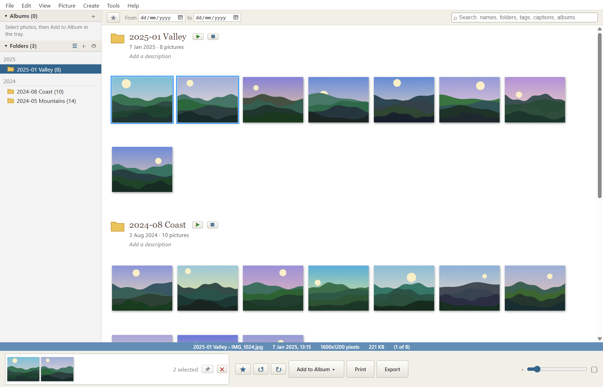
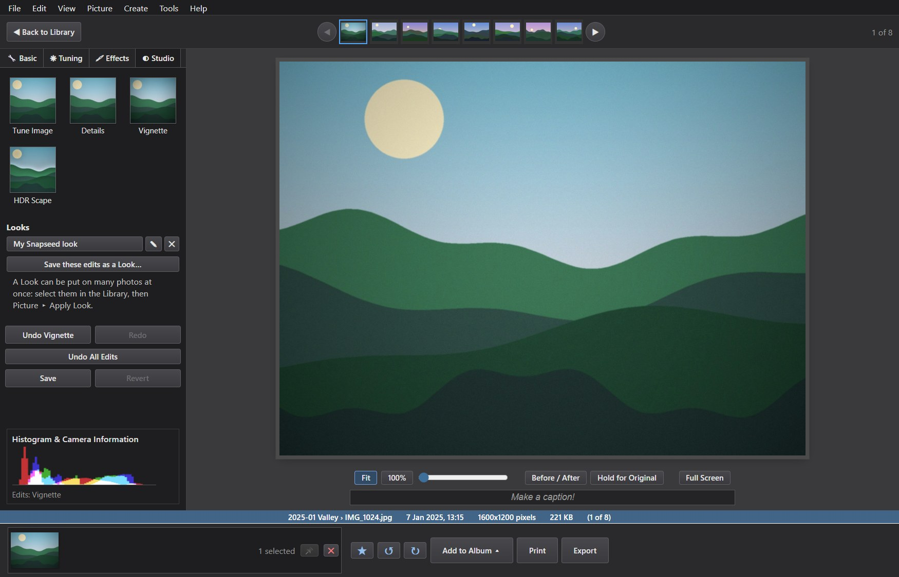

# CasaPic

A fast desktop photo organizer and editor for Windows, in the spirit of Picasa 3.

CasaPic shows every photo in the folders you choose and lets you star, tag, caption, sort them
into albums, and edit them. Edits do not change your photo files: they are kept beside the
photos as small text "recipes" until you choose to save.

CasaPic is an independent project. It is not made by, affiliated with, or endorsed by Google.
Picasa is a trademark of Google LLC. CasaPic contains no Picasa code.



## Features

The [user guide](docs/user-guide.md) explains each of these step by step.

**Library**
- Watches the folders you pick (Tools ▸ Folder Manager); new and changed photos appear by themselves.
- Folder list by year or as a tree, photo counts, folder descriptions, sorting, hiding.
- Thumbnails from small up to one photo per row. CasaPic remembers where you were in every
  folder, album and view, so coming back from a photo returns you to the same place.
- Stars, tags (Ctrl+T), captions, albums, search as you type (Ctrl+F), timeline, hidden photos.
- File actions: rename (F2), move, copy, cut/paste, drag between folders, delete to the Recycle
  Bin, adjust date and time, export, locate on disk.
- Reads JPEG, PNG, GIF, BMP, TIFF, WebP, and HEIC (when the Windows HEIC codec is installed).

**Editing** (double-click a photo)
- Basic fixes: crop, straighten, I'm Feeling Lucky, auto contrast, auto colour, fill light.
- Tuning: highlights, shadows, colour temperature, neutral colour picker.
- Effects: sharpen, sepia, black and white, warmify, film grain, tint, saturation, soft focus,
  glow, filtered black and white, focal black and white, graduated tint.
- **Studio**: Tune Image, Details, Vignette and HDR Scape, tools in the style of the Snapseed app.
- **Looks**: save a photo's edits as a named Look and put it on one photo or many at once
  (Picture ▸ Apply Look). A starter Look, "My Snapseed look", is included.
- Undo and redo, copy and paste all effects, batch edit, before/after view, flip.
- Zoom from Fit up to 400% with a slider, Ctrl+mouse wheel, and an overview map.
- Save writes the edited photo and keeps the untouched original in a hidden
  `.casapicoriginals` folder, so Revert always works.



**Viewing and output**
- Slideshow (Ctrl+4), full screen (F11), print and contact sheets (Ctrl+P), picture collages.

**Comfort**
- Light and dark colours, or follow Windows (Tools ▸ Options ▸ Colours).
- Every keyboard shortcut is listed under Help ▸ Keyboard Shortcuts (F1).
- Delete asks before moving a photo to the Recycle Bin; tick "Don't ask again" for this session
  or for good (turn it back on in Tools ▸ Options).

**Coming from Picasa?** Tools ▸ Import Picasa Settings reads your old `.picasa.ini` files and
brings across stars, edits, albums, hidden photos, captions and folder descriptions. Picasa's
own files are only read, never changed.

## Where CasaPic keeps things

| What | Where |
|---|---|
| Stars, edits, albums of a folder | a hidden `.casapic.ini` file in that folder |
| Tags and captions | inside the photo file (XMP and IPTC, as Picasa wrote them) |
| Untouched originals of saved photos | a hidden `.casapicoriginals` folder beside them |
| Settings, thumbnail cache, search index | `%LOCALAPPDATA%\CasaPic` |

A photo file changes only when you Save an edit, adjust its date, or give it tags or a caption.

## Install

CasaPic runs on Windows 10 and 11 (64-bit). It needs the Microsoft Edge WebView2 runtime, which
Windows 11 already has.

There are no ready-made downloads yet; build it from source as below.

## Build from source

You need:
- [Rust](https://rustup.rs) (a current stable version)
- [Node.js](https://nodejs.org) 20.19 or newer
- The Microsoft C++ Build Tools ("Desktop development with C++")

Then, in PowerShell:

```powershell
git clone https://github.com/giladfeldman/CasaPic.git
Set-Location CasaPic
npm ci
npx tauri build --no-bundle
```

The program is `target\release\casapic.exe`. Leave out `--no-bundle` to also get an installer
under `target\release\bundle\nsis`.

For development, `npx tauri dev` runs CasaPic with live reloading.

### Trying it on a test folder

Two settings keep CasaPic away from your real photos while you try it out:

```powershell
$env:CASAPIC_ROOTS = "C:\path\to\test-photos"; $env:CASAPIC_DATA = "C:\path\to\test-data"; .\target\release\casapic.exe; Remove-Item Env:\CASAPIC_ROOTS, Env:\CASAPIC_DATA
```

`CASAPIC_ROOTS` lists the folders to show (separated by `;`), and `CASAPIC_DATA` is where
settings and the thumbnail cache go.

### Tests

```powershell
cargo test --workspace
npm run check
```

## Project layout

| Folder | What is in it |
|---|---|
| `crates/core` | The image engine: decoding, thumbnails, edit recipes, every fix and effect |
| `src-tauri` | The desktop app shell: folders, file actions, the photo index, commands for the UI |
| `src` | The user interface (Svelte 5 and TypeScript) |

## Contributing

See [CONTRIBUTING.md](CONTRIBUTING.md). Security problems: see [SECURITY.md](SECURITY.md).

## Licence

CasaPic is free software under the GNU General Public License, version 3 or (at your option)
any later version. See [LICENSE](LICENSE).

<!-- license-citation:start -->
## License and citation

Copyright (C) 2026 Gilad Feldman.

This software is licensed under the [GNU Affero General Public License v3.0](LICENSE) (AGPL-3.0-only). You may use, study, modify and share it, including for commercial purposes, provided that the complete source code of any modified version is published under the same licence - including when the modified version is offered as a hosted online service.

**Commercial licences** without these conditions are available from the author: Gilad Feldman (https://orcid.org/0000-0003-2812-6599).

Versions released before 2026-11-06 were licensed under GPL-3.0 and remain available under those terms.

**How to cite.** If you use this software in research, please cite it. GitHub's *Cite this repository* button (from [CITATION.cff](CITATION.cff)) gives APA and BibTeX. In APA style:

> Feldman, G. (2026). *casapic* (Version 0.1.0) [Computer software]. https://github.com/giladfeldman/CasaPic

<!-- license-citation:end -->
